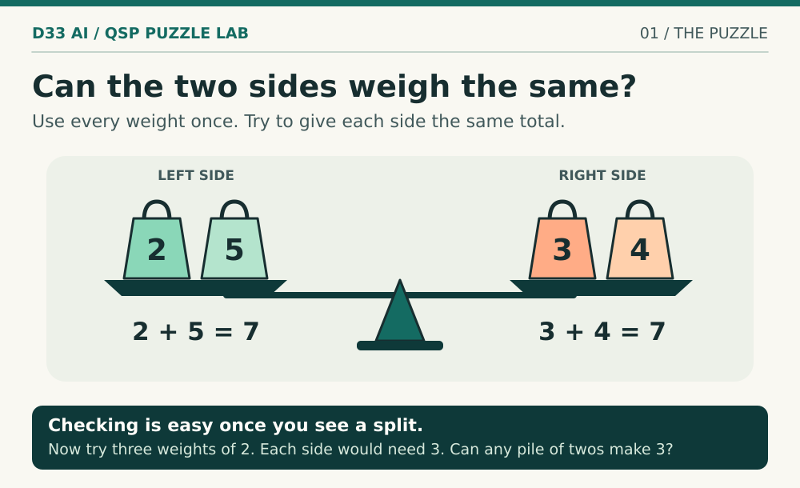
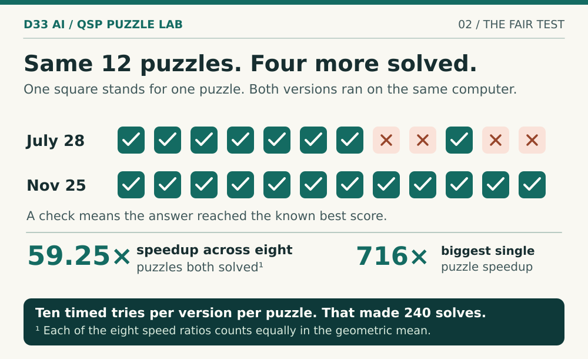
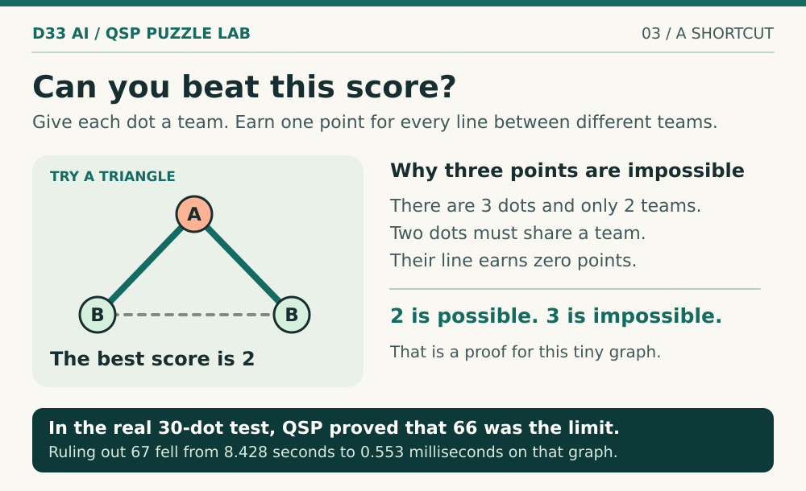
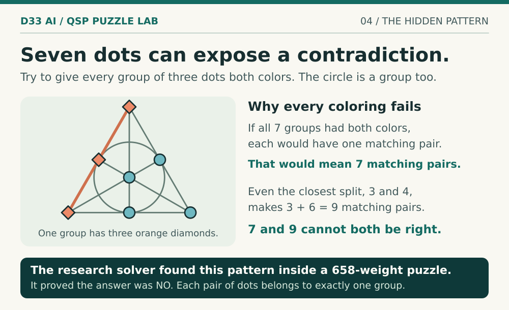

# How QSP solves puzzles

QSP is a computer program for choice puzzles. A choice can be as simple as putting a weight on the left or the right. We asked two questions. Can QSP find the best answer faster? And can it explain why a better answer is impossible?

## 1. What does a solution look like?

Imagine four weights marked 2, 3, 4 and 5. Use each one once to make two equal piles. Put 2 and 5 on the left and 3 and 4 on the right. Both sides weigh 7. Those piles are evidence anyone can check.

Now try 2, 2 and 2. The total is 6, so each side needs 3. Any pile of twos has an even total. That's a short proof that this puzzle has no solution. These two examples teach the rules.

## 2. Did QSP improve in 120 days?

We gave the July and November versions the same 12 puzzles on the same computer. An independent check told us whether each answer reached the best possible score. We timed each version ten times on each puzzle. That's 240 timed tries.

July got 8 of 12 right. November got all 12 right. Every one of the eight puzzles both versions solved took less time in November. Combining their eight speed ratios with equal weight gave a 59.25-fold speedup. On the biggest improvement, the wait dropped from about 1.22 seconds to 0.00171 seconds, about 716 times faster. That case still checked 1,048,576 choices. The other four puzzles count as repaired answers.

## 3. Can a clue save work?

Imagine putting dots on two teams. You earn a point for each line joining different teams. On a triangle, three points are impossible. With three dots and two teams, at least two dots must share a team. Their line earns no point. Putting the third dot on the other team earns two points, so two is the best score.

QSP's research solvers tried clues like dots with the same neighbors, loops, and groups where every dot touches every other dot. On one specially built 30-dot puzzle, six such groups proved the score could be at most 66. A team split actually scored 66. Together those facts settle the puzzle.

The previous research solver took **8.428 seconds** to rule out 67. The new one took **0.553 milliseconds**, less than a thousandth of a second. That was about **15,242 times faster on that question**. When we changed the graphs, the extra check sometimes cost time. On 12 comparison questions using signed edges, it won twice and was 4.9% slower by the middle per-question ratio. This experiment used a different starting solver from the 120-day test.

## 4. What was hidden inside the newest puzzle?

We built a list of **658 weights** with a secret pattern inside it. The program got the numbers in shuffled order. It worked out that splitting the weights equally would require coloring seven dots so every marked group of three had both colors.

Look at the drawing. There are seven groups. The circle counts as one group, and every pair of dots belongs to exactly one group. If a group has both colors, exactly one pair in that group matches. Seven mixed groups would therefore give exactly **seven matching pairs** in all.

But try dividing seven dots as evenly as possible: three orange and four blue. The orange dots make three matching pairs. The blue dots make six. That's already **nine**, and a less even split makes even more. Seven can't equal nine. So no coloring works, and the weights cannot be split equally.

Why bother finding the pattern? On the 658-weight puzzle, a proof that lists failures from just one group at a time needs at least **134,217,728 entries** to rule out all choices. That number comes from counting what one entry can cover. Recognizing all seven groups gives the short proof above. A separate checker called **Z3** agreed on all 12 puzzles it checked, including both possible and impossible ones, up to 4,039 weights.

## What does this have to do with P versus NP?

You could check the first two piles in seconds. P versus NP asks whether every kind of yes-or-no puzzle with quickly checkable YES answers also has a method that always finds the correct answer in polynomial time. That's a precise rule about how the number of steps grows with the size of the input.

We found shortcuts for particular puzzle families. We also found a counting rule for the whole three-bit family, but its list of terms can grow exponentially. A method proven fast enough on **every** puzzle in this NP-complete family would settle P = NP. That part is still open.

[Full scorecard](../benchmarks/scorecard.md) · [Scientific fact sheet](../reports/scientific-fact-sheet.pdf) · [Three-bit proof and repeatable checks](../research/three_bit_partition/README.md) · [Clay Mathematics Institute](https://www.claymath.org/millennium/p-vs-np/)
