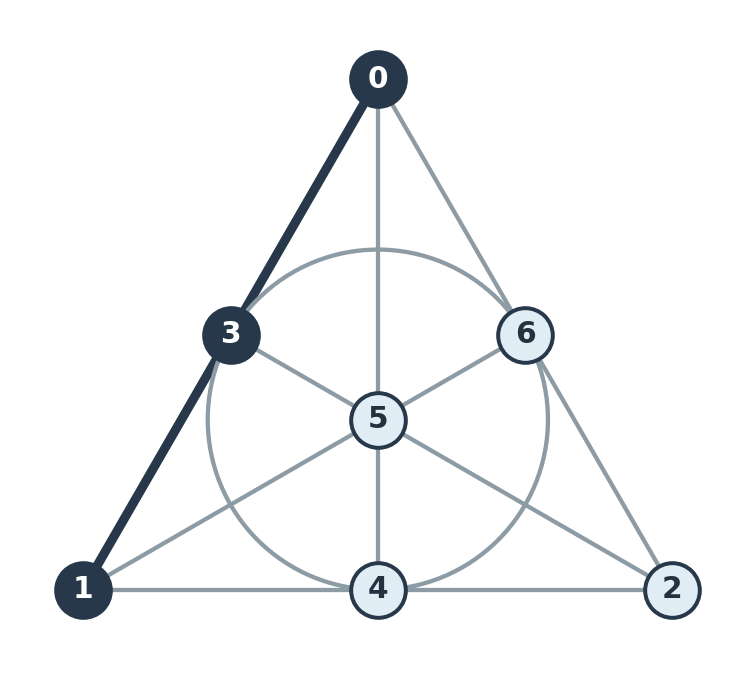

# Abstract

How much work does a proof format create when it hides the structure of a problem? We construct a family of equal-sum partition instances whose positive integer weights have at most three set bits. The public input consists only of those integers. Seven hidden parity values encode the lines of the Fano plane. We prove that a flat list of individual-bit conflicts, each justified by one original line, needs exactly $7\cdot 2^{3g-2}$ entries for odd block width $g$. At $g=9$, this is 234,881,024 entries for a list of 658 integers. We give a deterministic algorithm that reconstructs the parity constraints from the integers and certifies infeasibility by counting pairs of seven points. A matched family with feasible partitions controls for size and layout. Exhaustive checks verify the exact cover at widths one and three. An independent Z3 encoding agrees on 12 shuffled instances across six widths. The separation concerns a specified certificate format on a constructed family. Its significance for QSP is a concrete criterion for changing problem representation during exact search.

**Keywords** Integer partition · parity substitution · proof complexity · algorithm selection · reproducible optimization

## In plain language

Imagine dividing numbered cards into two piles with equal totals. Our cards hide seven yes-or-no choices. Checking raw choices one group at a time requires a very long list of reasons the split fails. Once a solver recovers the seven choices, a short counting argument settles the puzzle. We also give it look-alike decks that *can* be split. For each of those, it must hand back actual cards whose totals match.

**Review question.** Does each impossibility claim follow under its stated proof rules, and can another implementation recover the same answers from the integers alone?

::: pagebreak
:::

# 1 The problem and the seven-point obstruction

An instance consists of indexed positive integers $w_1,\ldots,w_n$. Equal-valued items retain distinct indices. A solution is a binary vector $x$ satisfying $2\sum_i w_i x_i=\sum_i w_i$. We restrict each weight to a sum of at most three distinct powers of eight. At most four weights use any one base-eight digit. Neither pile can produce a carry. Equality therefore holds exactly when each occupied digit occurs equally often in the two piles. An odd digit frequency immediately rules out a solution. Digits of frequency two enforce exactly one selected item, and digits of frequency four enforce exactly two.

**A small example.** The weights 1, 8 and 9 form a valid instance. Each occupied digit occurs twice. Selecting the card 9 places one occurrence of each digit on its side. The other side has 1 + 8. This is the digit-by-digit test the larger constructions use.

On points numbered 0 through 6, take the seven lines $\{i,i+1,i+3\}$, with addition modulo seven. Every line contains three points. Every pair occurs once, and two distinct lines meet in exactly one point. The Fano plane is a classical obstruction to two-colorability [1]. For completeness, suppose every line contained both colors. Each line would contribute exactly one same-color pair, giving seven in total. Even the most balanced split of the points, three of one color and four of the other, has $\binom{3}{2}+\binom{4}{2}=9$ such pairs. This contradiction proves infeasibility.

{width=4.15in}

::: pagebreak
:::

# 2 Encoding the obstruction as integers

A digit row lists the indices of weights containing that digit. To realize a four-port parity constraint, make four rows indexed by the vertices of the complete graph $K_4$. Give each graph edge one item present at its two endpoints. Give each vertex one additional port item. Every row now has four items and must select two.

**Lemma 1 (the four-port gadget).** A boundary pattern $b_1,\ldots,b_4$ extends to the six edge items exactly when its parity is even.

*Proof.* At vertex $i$ the selected internal degree must be $2-b_i$. The sum of those degrees is even. Conversely, zero selected ports allow a four-cycle, and four allow a perfect matching. For two selected ports, take a path visiting all four vertices with those ports at its endpoints. These cases realize every even pattern. ∎

For odd $g\ge3$, join $m=(g-1)/2$ gadgets into a path. A bridge is one item present at a free port of each neighboring gadget. There are $4m-2(m-1)=g+1$ exposed ports. Designate $g$ as inputs and one as output. Summing gadget parity equations modulo two cancels the bridges, so the output equals the XOR of the inputs. Conversely, fix the exposed values with even parity and visit the path from one end. Each outgoing bridge is forced. At the last gadget, total parity gives consistency. Lemma 1 fills in every gadget.

For each point $p$, introduce $g$ boundary items. For each of the three lines containing $p$, take a fresh path fed by those same $g$ items. Each shared input now touches exactly three distinct rows. At each line add a quartet row containing its three outputs and a private slack item. There is a legal slack value precisely when the outputs sum to one or two, i.e., when the three colors are mixed. Path edges, bridges and outputs touch two rows. Slacks touch one. At width one, omit the paths and use the point items directly.

**Size and control.** With 21 paths the instance uses $7+84m$ digits and $7g+7+147m$ weights. The latter counts $7g$ shared inputs, seven slacks, and $6m+(m-1)+1$ internal, bridge and output items per path. The formulas also give 7 digits and 14 weights at $g=1$. Replacing the triples by $\{i,i+1,i+2\}$ produces a feasible control with identical counts and port degrees. Alternating colors around the seven points gives one valid control coloring.

::: pagebreak
:::

# 3 Exact size of a one-line conflict cover

A *boundary assignment* specifies the $7g$ individual input bits. A partial assignment fixes some of those bits and denotes the subcube of all full assignments extending it. It is a *one-line conflict* if there is an original line such that its three attached paths and quartet row have no completion consistent with those fixed bits. Shared boundary values persist, while auxiliary choices in that subsystem are free. A *flat cover* is a list of such subcubes whose union is the entire boundary cube. The cost is the number of entries. A single entry cannot cite a derived parity, a disjunction of conflicts, earlier entries, or several lines jointly.

**Theorem 1.** For odd $g\ge1$, the minimum number of entries in a one-line flat cover of the encoded Fano instance is exactly

$$M_1(g)=7\cdot 2\,(2^{g-1})^3=7\cdot 2^{3g-2}.$$

*Upper bound.* Choose a line, a common color, and a full $g$-bit word of that parity for each of its three points. Fix those words and leave the other four blocks free. The chosen line fails. There are seven line choices, two colors, and $2^{g-1}$ words per block and color. Every full assignment has a failed line by the pair count in Section 1, so the listed subcubes cover it.

*Lower bound.* Any conflict justified by a particular line fixes all bits of each of its three blocks. If one block has a free bit, it can be given either parity. Choose its parity to obtain a mixed triple, choose the slack, and extend the paths by Lemma 1. If all three parities are fixed but mixed, the same extension exists. Thus every conflict lies inside a single fully specified monochromatic local pattern for its justifying line.

For each listed local pattern, extend the other four blocks to the opposite parity. Every other line meets the chosen line once and contains two points outside it. Only the chosen line fails. Any cover entry containing this private extension must cite that line and fix these exact three words. A single entry cannot serve private extensions for two different patterns. Each pattern therefore requires a separate entry, matching the upper bound. ∎

**Numerical consequence.** At width one the minimum is 14. At width three it is 896. At width nine it is 234,881,024. The earlier volume estimate $2^{3g}$ gives 134,217,728 at width nine. The private-extension argument closes the gap by accounting for which conflicts are indispensable. These numbers count proof entries. They do not predict how many steps a general SAT solver will take.

::: pagebreak
:::

# 4 What survives stronger inference?

**Proper subsystems.** Allow an entry to cite any proper subset of the seven lines, together with its attached paths. Any such subsystem is colorable. Choose an omitted line, give its three points one color and the other four points the opposite color. Swapping colors allows any one prescribed point color. If a partial assignment fully fixes at most one block, each partly fixed block can still attain either parity. It therefore extends to a coloring of that subsystem. Each valid conflict must fix at least two entire blocks. Its volume is at most $2^{5g}$ out of $2^{7g}$, so at least $2^{2g}$ entries are necessary. We give no matching upper bound for this stronger format.

**Parity preprocessing.** Every boundary assignment also extends to the parity relaxation of all digit rows. Complete the paths from the assigned point parities and use each private slack to make its quartet even. Hence parity equations alone exclude no boundary assignments on this family. Global reasoning that combines parity with the exact-cardinality constraints can be decisive.

**Corollary (edge-minimal obstructions).** In the abstract cover problem, let $H$ be a finite $k$-uniform hypergraph that is not two-colorable but becomes two-colorable after deleting any edge, with $k\ge2$. Give each vertex its own disjoint $g$-bit parity block and require every edge to be mixed. The exact one-edge cover size is

$$|E(H)|\,2^{1+k(g-1)}.$$

*Proof.* Listing the failed-edge patterns gives the upper bound. Deleting edge $e$ yields a coloring that must fail on $e$ and on no other edge. Complementing the coloring realizes either monochromatic color on $e$. Each local pattern therefore has a private extension. A free bit in any touched block still allows its edge to be made mixed. The lower-bound argument of Theorem 1 now applies. ∎

This corollary concerns abstract parity substitution. The specific bounded-occurrence integer encoding in Section 2 uses the Fano plane's three incidences per point and its three points per line.

**Scope in proof complexity.** A straightforward binary listing of our inputs uses $L=O(g^2)$ bits. The exact one-line cover grows faster than any polynomial in $L$. All seven lines together admit the short pair-count proof. Resolution, branching on auxiliary variables, and other proof systems have different rules and can reuse intermediate information. Theorem 1 gives no lower bound for those systems. Prior work on parity encodings and proof-system tradeoffs makes the choice of proof rules material [2, 3].

::: pagebreak
:::

# 5 Recovering the hidden variables

The solver receives shuffled integers with permuted digit coordinates. The generator's labels and intended answer are withheld. It first decodes each integer and reconstructs the digit-to-item incidences. It requires four items in every row of the recognized template. One-digit items identify candidate core rows. On remaining rows, two-digit items define edges. In the gadget graph an internal $K_4$ edge has two common neighbors and a bridge has none. The recognizer checks four-cliques, single external ports, connections between cliques, a path per region, and one output per path. It checks the support of every core input and the incidence of all three-digit items. A layout outside these checks is reported as unsupported.

Each recovered path defines an output parity on its input items. Equal supports can be grouped. Write $y=Ax$ over the two-element field for the vector of grouped parities. Binary Gaussian elimination selects original columns that span the image of $A$. If $r$ is their rank, enumerate the $2^r$ attainable output vectors and test the core triples. For a feasible vector, its chosen basis columns give raw boundary bits. Fill in the path outputs, slacks, bridges and clique edges. Finally, verify the selected integers sum to exactly half the total.

**Proposition 2.** On layouts accepted by the recognizer, the algorithm decides feasibility in $2^r\operatorname{poly}(L)$ time and returns a checked integer witness for a YES instance.

*Justification.* Each validated path projects exactly to its parity equation by Lemma 1. Each quartet admits its slack exactly for mixed triples. The image enumeration is complete, and reconstruction reverses each elimination. Recognition, row reduction, and all per-vector operations have polynomial cost in the explicit binary input length $L$. On a seven-point core covering all 21 pairs exactly once, the pair-count proof certifies NO directly without enumerating the image. ∎

On the Fano family $r=7$ at every width. A cyclic family on $n\ge5$ points with triples $\{i,i+1,i+2\}$ and one input per point has identity output map and rank $n$. The bound guarantees polynomial time when $r=O(\log L)$ on a validated layout. The present algorithm supplies no such bound for arbitrary inputs.

**Relation to P versus NP.** The decision problem for the entire sparse input class is NP-complete (Appendix A). A correct polynomial-time algorithm over that entire class would imply P = NP. The shortcut here covers one recognizable structure. A lower bound for its local proof competitor also leaves open the possibility of a different polynomial-time algorithm. The general P versus NP question remains open [5].

::: pagebreak
:::

# 6 Computational checks and benchmark context

We fixed six odd widths and paired each Fano NO instance with a cyclic YES control. Three shuffles per family and width permuted items and digits. A fourth shuffle went to a separate SAT encoding. The code checks integer sums directly for each positive witness. The point colorings have 128 possibilities per family: the Fano core accepts zero and the cyclic core accepts 28.

| Width | Integer weights | Occupied digits | Boundary bits | Z3, Fano / cyclic |
|----:|----:|----:|----:|:---|
| 1 | 14 | 7 | 7 | UNSAT / SAT |
| 3 | 175 | 91 | 21 | UNSAT / SAT |
| 5 | 336 | 175 | 35 | UNSAT / SAT |
| 9 | 658 | 343 | 63 | UNSAT / SAT |
| 21 | 1,624 | 847 | 147 | UNSAT / SAT |
| 51 | 4,039 | 2,107 | 357 | UNSAT / SAT |

**Structure and certificates.** The recognizer returned 18 NO certificates and 18 feasible integer witnesses. All 16 external gadget patterns were checked against all 64 internal edge settings. Two hundred seeded parity maps were compared to brute-force enumeration. For $g=1,3,5,9$, elimination on raw rows confirmed zero projected parity restrictions on the boundary. The new cover replay checks all 128 and 2,097,152 raw assignments at widths one and three, and checks a private extension of each of the 14 and 896 necessary patterns.

**Independent encoding.** Z3 [6] reads integer-derived quartet rows through eight clauses per row, one clause excluding each all-true or all-false triple. All 12 decisions agreed. Z3 and the structural solver share the instance generator. The different encodings help detect interpretation errors, while external replication and blinded out-of-family tests remain open.

**Historical QSP benchmark.** A separate experiment compared the July 28 and November 25 production snapshots retrospectively on one CPU. Verified optima rose from 8/12 to 12/12 on fixed QUBO/Max-Cut fixtures. The eight jointly correct cases improved by a geometric mean of 59.25×. The largest ratio, 716.08×, occurred on a 20-variable integer QUBO that still considered all 1,048,576 assignments. Each time is the median of ten measurements per version per fixture (240 samples). The older QOBLIB screenshot uses a different instance list. Neither its denominator nor these production timings enter the sparse-PARTITION experiment. Full scorecard, raw times and timing verifier are in the review materials [7].

::: pagebreak
:::

# 7 Related work, interpretation and review

The Fano plane supplies a classical minimal obstruction for hypergraph coloring [1]. Parity also has a familiar exponential cost when expressed directly in CNF without auxiliary variables [2]. Research on proof systems treats width, space and allowed inference rules as distinct resources [3]. Scheffler proves bounded-occurrence hardness for monotone exact-two-of-four constraints [4]. These results provide the ingredients and delimit the possible novelty claim.

The contribution presented for review is the **exact optimum for a defined cover format**, realized by bounded-incidence sparse integers, with a solver that recovers the useful variables from those same integers. The private-extension proof explains the multiplicative factor missed by volume counting. The construction makes a concrete prediction a reviewer can challenge: a smaller claimed cover must either change the admissible evidence or cover two private extensions with a single valid entry. The scoped literature comparison leaves priority for the combined result open.

**Experimental limitations.** The two synthetic families share a design. Shuffling removes labels but preserves structure. The 36 recognition tests characterize repeatability under relabeling, not the frequency of these structures in applied optimization. The present study supplies an exact prototype and counts certificates. It measures neither a production routing improvement on unseen inputs nor a quantum-hardware effect.

**Recommended next experiment.** Freeze the recognizer, generator configuration and equal time budgets. Have a second implementer prepare unlabeled families including unseen obstructions, cyclic controls, and near-miss gadgets. Compare the QSP route, generic SAT and a simple exact baseline on the same integers. Record unsupported and unknown outcomes, false certificates, checked witnesses, wall times including recognition, and independently checked NO evidence. Report every instance. The decisive operational question is how often recognizing structure helps after paying the cost of looking for it.

## Availability and contributor information

Kellar A. Moore and Troy Hamner are listed as contributors from D33 AI. Version 1.0 is a technical preprint issued for independent review. The companion includes the manuscript source, a figure, the exact integers and witness for two 658-weight examples, generators, verifiers and recorded results. Appendix B gives the replay commands. The experiments reported here ran on classical hardware.

::: pagebreak
:::

# Appendix A Hardness and an exact counting formula

**Hardness of the entire input class.** Start with monotone exact-two-in-four satisfiability, NP-complete even in a restricted occurrence setting [4, Theorem 21]. Give each literal occurrence its own Boolean clone and impose a four-clone exact-two row for each clause. In an arbitrary order of the clones of each variable, join consecutive clones $u,v$ by two exact-one rows $(u,t)$ and $(t,v)$ with fresh $t$. These imply $u=v$ and permit either common value. This works even if an original clause repeats a variable. Every clone appears in at most three rows (one clause and at most two links). Each helper appears twice. Assign a fresh digit to each row and make one weight per variable or helper from its incident digits. Balancing each digit is exactly the required constraint. Row count is linear in the source size, and the explicit integer listing is polynomial in it. A satisfying assignment gives a partition and a partition induces a satisfying assignment. Integer witness checking is polynomial, proving NP-completeness.

**Counting all indexed balanced subsets.** Reject any instance with an odd-frequency digit. For the remaining rows take their required parity: one for a pair, zero for a quartet. Denote this affine system over the two-element field by $H$. Inside $H$, an invalid quartet consists of four equal bits. In row $i=(a,b,c,d)$, the two extra equations $a=b$ and $a=c$ force $a=b=c=d$. Write $B_i$ for these equations and $m$ for the number of quartet rows. Let $C(S)$ count the solutions of $H$ together with $B_i$ for $i\in S$. Then

$$N=\sum_{S\subseteq\{1,\ldots,m\}}(-1)^{|S|}C(S).$$

By elimination, $C(S)=0$ for an inconsistent augmented system and $C(S)=2^{n-r_S}$ otherwise, where $r_S$ is the rank of its coefficient matrix. Inclusion–exclusion counts exactly the assignments violating no row. The formula can have $2^m$ terms. As checks, the implementation agreed with direct integer counting on every admissible nonempty multiset of at most six weights over four digit positions: 23,211 cases, including 1,810 YES. Another 600 seeded cases agreed, including 367 YES. These are counts of indexed subsets, so complements count separately.

A chain with rows $(a_{i-1},a_i,b_i,c_i)$ illustrates the limit of merging identical affine intersections. After eliminating $c_i$, the two bad-row equalities per row form the edges of a tree on the $2m+1$ free variables. Its $2m$ comparisons are independent. Hence all $2^m$ intersections are distinct, although their counts depend only on $|S|$. The binomial sum yields $N=2\cdot 3^m$, checked for $m=1$ through 10. Other factorizations may exist outside the chain.

::: pagebreak
:::

# Appendix B Replay and bibliography

Unpack the companion archive and run these commands from its root. Python 3.10 or later suffices for the standard-library checks. The SAT check also requires the Z3 shared library discoverable by Python's system loader. Each SAT instance has a six-second budget and may return `unknown` on a different installation. Inspect the JSON outcomes when comparing runs.

```sh
python three_bit_partition/study.py
python three_bit_partition/affine_count.py
python three_bit_partition/z3_check.py
python three_bit_partition/check_examples.py
python hidden_parity/verify_cover.py
python benchmarks/verify_timings.py
```

The first three commands emit structured results comparable with the archived JSON. The fourth checks the supplied hexadecimal integers and selected indices. The fifth exhaustively covers the two small cubes and checks their private witnesses. The sixth recomputes timing statistics from the original samples. A SHA-256 manifest identifies the packaged files. Re-timing the historical production revisions requires those solver versions.

## References

[1] Y. Person and M. Schacht. Almost all hypergraphs without Fano planes are bipartite. *Proceedings of the 20th ACM–SIAM Symposium on Discrete Algorithms*, 217–226 (2009). [Publisher](https://doi.org/10.1137/1.9781611973068.25)

[2] G. Emdin, A. S. Kulikov, I. Mihajlin and N. Slezkin. CNF Encodings of Parity. *MFCS 2022*, LIPIcs 241, 47:1–47:12 (2022). [Open access](https://doi.org/10.4230/LIPIcs.MFCS.2022.47)

[3] C. Berkholz and J. Nordström. Supercritical Space-Width Trade-offs for Resolution. *ICALP 2016*, LIPIcs 55, article 57 (2016). [Open access](https://doi.org/10.4230/LIPIcs.ICALP.2016.57)

[4] R. Scheffler. The distance orientation problem. *Discrete Applied Mathematics* 323, 324–342 (2022), Section 6, Theorem 21. [Publisher](https://www.sciencedirect.com/science/article/pii/S0166218X22002025)

[5] S. Cook. The P versus NP Problem. *Clay Mathematics Institute, Millennium Prize Problems*. [Problem statement](https://www.claymath.org/millennium/p-vs-np/)

[6] L. de Moura and N. Bjørner. Z3: An Efficient SMT Solver. *TACAS 2008*, LNCS 4963, 337–340 (2008). [Publisher](https://doi.org/10.1007/978-3-540-78800-3_24)

[7] D33 AI. QSP exact solver across 120 days. Scorecard and 240 retrospective solve times, public snapshot (2026). [Versioned benchmark](https://github.com/D33Ai/QSP-Benchmark-Research/tree/be5b404dfe9e668bd332dc835f78c752a935dfcd/benchmarks)
